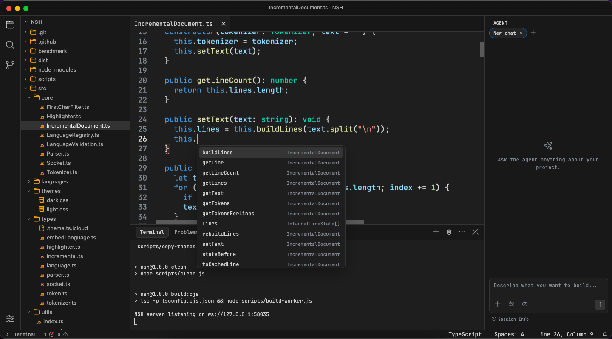

<p align="center">
  
</p>

<h1 align="center">NCE</h1>

<p align="center">
  <strong>A lightweight and fast desktop code editor built from scratch.</strong>
</p>

<p align="center">
  Built with Electron · macOS · Windows · Linux
</p>

---

<p align="center">
  
</p>

## About

**NCE (NDL Code Editor)** is a lightweight desktop code editor built from the ground up with a strong focus on:

- **Performance**
- **Simplicity**
- **Full control over the editor architecture**

The editor core was designed and implemented from scratch, without relying on prebuilt editor engines such as **Monaco Editor** or **CodeMirror**.

Text rendering, cursor handling, selections, history, scrolling, file management and editing behaviour are handled by NCE's own architecture.

NCE also includes a deeply integrated AI coding agent designed to work directly with the editor, workspace, files and project tooling.

**Current version**: **0.0.1-beta.5**

## Beta 5 highlights

- Source Control sidebar with status, staging, unstaging and workspace-scoped commits
- Native read-only diff view rendered in editor tabs, with syntax colors and virtualized scrolling
- Hardened Git execution: bounded command queue, single-flight status, scrubbed environment, process-group timeouts, trusted Git resolution and explicit `index.lock` reporting
- Agent sidebar loading, empty and failure states with real retry and lazy ghost-shell placeholders
- Typed Myers line diff with a bounded fallback, capped and auto-refreshed diff tabs
- Per-architecture node-pty packaging verified with `lipo`, fixing the beta 4 Intel terminal

## Getting Started

### Requirements

- Node.js 20+
- npm
- Git

### Installation

```bash
git clone https://github.com/developper259/NCE.git
cd NCE
npm ci
```

### Run

```bash
npm start
```

## Development

Language server architecture, configuration and tests are documented in [docs/lsp.md](docs/lsp.md).

The package installer (used to install Git when it is missing) is documented in [docs/installer.md](docs/installer.md).

Run the test suite:

```bash
npm test
```

Run type checking:

```bash
npm run typecheck
```

## Build

Create a production build:

```bash
npm run build
```

Build both macOS architectures (Intel and Apple Silicon):

```bash
npm run build:mac
```

Create an unpacked build:

```bash
npm run dist
```

Build artifacts are generated in `release/`.

## Status

NCE is currently in beta and under active development.

Current version: **0.0.1-beta.5**

## License

NCE is licensed under the **ISC License**.
