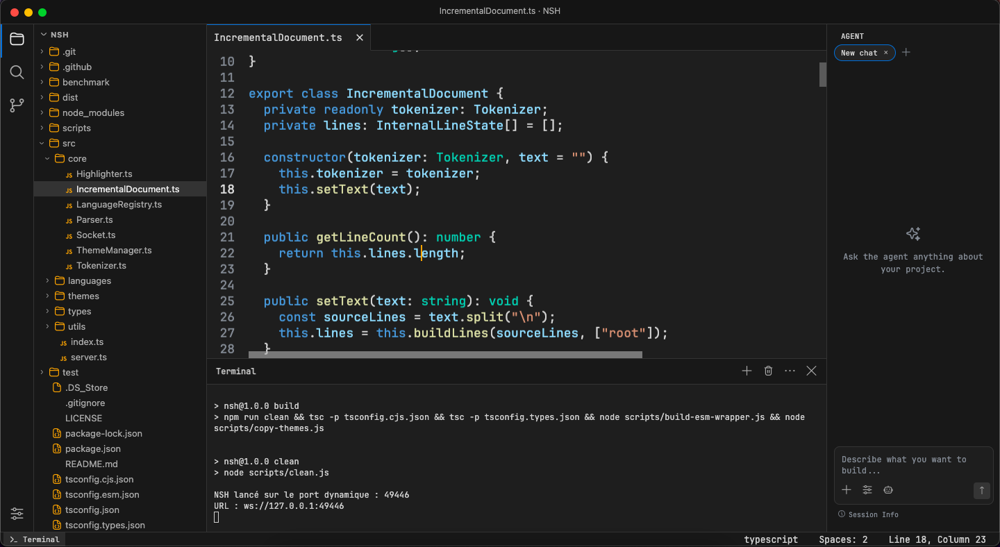

<p align="center">
  
</p>

<h1 align="center">NCE</h1>

<p align="center">
  <strong>A lightweight and fast desktop code editor built from scratch.</strong>
</p>

<p align="center">
  Built with Electron · macOS · Windows · Linux
</p>

---

<p align="center">
  
</p>

## About

**NCE (NDL Code Editor)** is a lightweight desktop code editor built from the ground up with a strong focus on:

- **Performance**
- **Simplicity**
- **Full control over the editor architecture**

The editor core was designed and implemented from scratch, without relying on prebuilt editor engines such as **Monaco Editor** or **CodeMirror**.

Text rendering, cursor handling, selections, history, scrolling, file management and editing behaviour are handled by NCE's own architecture.

NCE also includes a deeply integrated AI coding agent designed to work directly with the editor, workspace, files and project tooling.

**Current version**: **0.0.1-beta.5**

## Beta 5 highlights

- Source Control sidebar with status, staging, unstaging and workspace-scoped commits
- Native read-only diff view rendered in editor tabs, with syntax colors and virtualized scrolling
- Hardened Git execution: bounded command queue, single-flight status, scrubbed environment, process-group timeouts, trusted Git resolution and explicit `index.lock` reporting
- Agent sidebar loading, empty and failure states with real retry and lazy ghost-shell placeholders
- Typed Myers line diff with a bounded fallback, capped and auto-refreshed diff tabs
- Per-architecture node-pty packaging verified with `lipo`, fixing the beta 4 Intel terminal

## Features

### Editor

- Fast custom editing engine
- Multi-cursor editing with multiple selections
- Virtualized vertical and horizontal rendering for large documents
- Syntax highlighting powered by [NSH](https://github.com/developper259/NSH)
- Undo & Redo
- Smart typing and automatic pairs
- Smart indentation
- Cut, copy and paste
- Large file mode for opening very large files
- Local NSH failure fallback so the editor remains usable without highlighting

### Tabs and Views

- Multiple file tabs with horizontal scrolling and tab cycling
- Dedicated Settings tab
- Image preview tab for png, jpeg and other image files
- Markdown preview tab
- Tab type picker and "change view type" action for switching between views

### Workspace and Files

- File Explorer with create, rename, copy, move, duplicate and delete operations
- Virtualized File Explorer with a persistent tree
- Removals sent to the system Trash by default, with optional permanent delete
- Configurable confirmations for file and non-empty folder removal
- Persistent workspace file index, kept up to date by the file watcher
- Automatic large workspace mode for very large projects
- Persistent recent workspaces with Open Recent
- Multi-window support with isolated windows and per-window state
- Native opening of files and folders from the system
- Drag and drop files and folders onto the editor to open them
- Session restoration for workspaces, tabs, cursor, selection and scroll position
- Crash recovery that restores unsaved buffers automatically
- Merge of external file changes with local edits
- Auto Save with coalesced writes
- Safe dirty-file flows for close, quit, reload and workspace switching
- Atomic file saves with large, binary and invalid UTF-8 file protection

### Search and Navigation

- Recursive workspace search with include/exclude filters
- Progressive, streamed and virtualized search results
- Complete and safe workspace Replace All, including empty replacements
- Find in file with selection prefill and current-file search options
- Quick Open (Mod+P) served from the workspace index
- Go to Line (Mod+G)
- Command Palette (Mod+Shift+P)
- Recently used items in the quick panel

### Terminal

- Integrated terminal built on xterm and a native PTY
- Multiple terminal sessions with stable names and session management
- Sessions and panel state persisted per workspace
- Extensible bottom panel manager
- Clipboard shortcuts and Shift+Arrow text selection in the terminal

### AI Agent

- Integrated AI coding agent with project-aware tools, testing and multi-file editing
- Persistent Agent conversations with windowed rendering for long histories
- Manual context for files, folders and selections
- Safe handling of concurrent Agent runs
- Per-model visibility controls and provider API key management

### Customization and Settings

- Searchable settings with persistent category and scroll position
- Configurable keyboard shortcuts
- Configurable Open Recent window behavior
- Customizable sidebar panels
- Light, dark and system themes
- Native macOS menu and integrated Windows/Linux title bar menu

### Performance and Reliability

- Lazy initialization of heavy features and a split renderer bundle for faster startup
- Centralized scroller management and per-frame layout batching
- Built-in runtime performance dashboard
- Cross-platform desktop support

## Getting Started

### Requirements

- Node.js 20+
- npm
- Git

### Installation

```bash
git clone https://github.com/developper259/NCE.git
cd NCE
npm ci
```

### Run

```bash
npm start
```

## Development

Run the test suite:

```bash
npm test
```

Run type checking:

```bash
npm run typecheck
```

## Build

Create a production build:

```bash
npm run build
```

Build both macOS architectures (Intel and Apple Silicon):

```bash
npm run build:mac
```

Create an unpacked build:

```bash
npm run dist
```

Build artifacts are generated in `release/`.

### Release signing

macOS releases are built without an Apple Developer certificate or notarization. No Apple signing credentials are required; Gatekeeper may block the downloaded app.

Windows releases are built without code signing. No Windows signing credentials are required; SmartScreen may warn about or block the downloaded installer.

All platforms run an automated PTY smoke test against the packaged `app.asar`.

## Status

NCE is currently in beta and under active development.

Current version: **0.0.1-beta.5**

## License

NCE is licensed under the **ISC License**.
