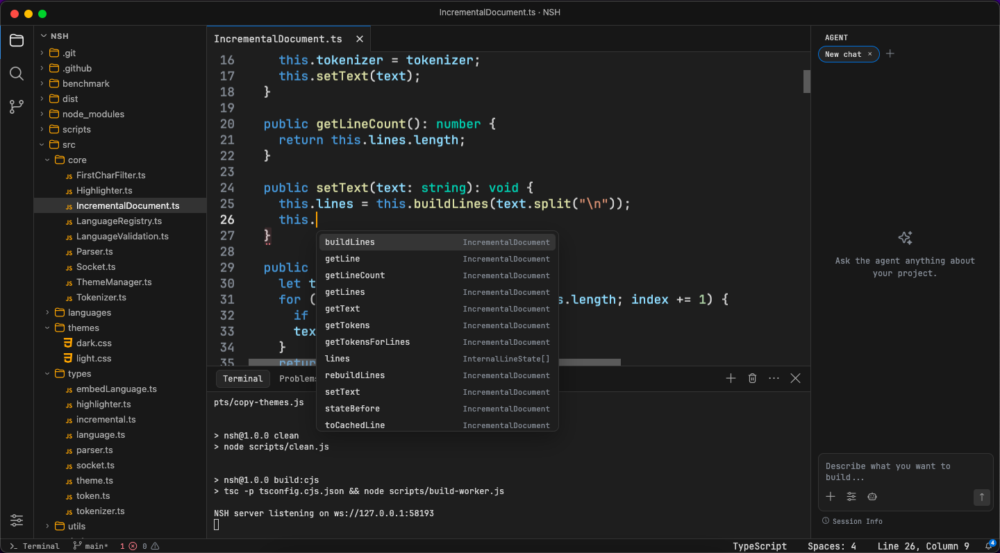

<p align="center">
  
</p>

<h1 align="center">NCE</h1>

<p align="center">
  <strong>A lightweight and fast desktop code editor built from scratch.</strong>
</p>

<p align="center">
  Built with Electron · macOS · Windows · Linux
</p>

---

<p align="center">
  
</p>

## About

**NCE (NDL Code Editor)** is a lightweight desktop code editor built from the ground up with a strong focus on:

- **Performance**
- **Simplicity**
- **Full control over the editor architecture**

The editor core was designed and implemented from scratch, without relying on prebuilt editor engines such as **Monaco Editor** or **CodeMirror**.

Text rendering, cursor handling, selections, history, scrolling, file management and editing behaviour are handled by NCE's own architecture.

NCE also includes a deeply integrated AI coding agent designed to work directly with the editor, workspace, files and project tooling.

**Current version**: **0.0.1-beta.6**

## Beta 6 highlights

- Full remote workflow in Source Control: fetch, pull, push and header sync actions with network progress, cancellation, a pinned status strip, remote management and an Add remote action for branches without upstream
- Repository clone with folder picker, progress, safe cleanup and direct project opening
- Paginated commit history with commit inspection, per-file versions and commit comparison
- Validated discard with confirmation, merge/rebase abort banner and an accordion layout with animated pinned section headers
- Transactional package installer that installs a verified Git (dugite-native) from Source Control, with configurable `git.path`, uninstall and real cancellation
- Multi-server language intelligence: completions, on-demand hover, go to definition, live diagnostics and a Problems panel with bottom-bar counts
- Centralized notifications with toasts, a notification center and Git, Files and Agent integrations
- Redesigned Search sidebar with filter toggle and collapsible file groups
- Native context menus for Settings and Source Control actions, Open Folder and Clone Repository in the explorer, and a Settings tab pinned to the leftmost slot
- Configurable terminal shell arguments, unified terminal rendering and background workers moved to utility processes

## Getting Started

### Requirements

- Node.js 20+
- npm
- Git

### Installation

```bash
git clone https://github.com/developper259/NCE.git
cd NCE
npm ci
```

### Run

```bash
npm start
```

## Development

Language server architecture, configuration and tests are documented in [docs/lsp.md](docs/lsp.md).

The package installer (used to install Git when it is missing) is documented in [docs/installer.md](docs/installer.md).

Run the test suite:

```bash
npm test
```

Run type checking:

```bash
npm run typecheck
```

## Build

Create a production build:

```bash
npm run build
```

Build both macOS architectures (Intel and Apple Silicon):

```bash
npm run build:mac
```

Create an unpacked build:

```bash
npm run dist
```

Build artifacts are generated in `release/`.

## Status

NCE is currently in beta and under active development.

Current version: **0.0.1-beta.6**

## License

NCE is licensed under the **ISC License**.
